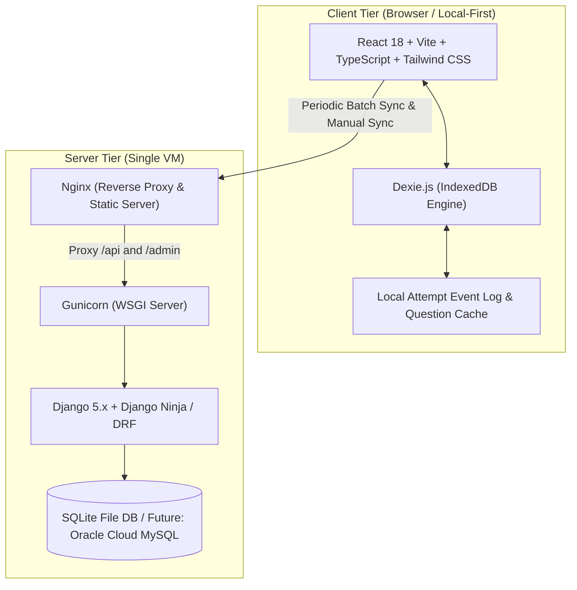
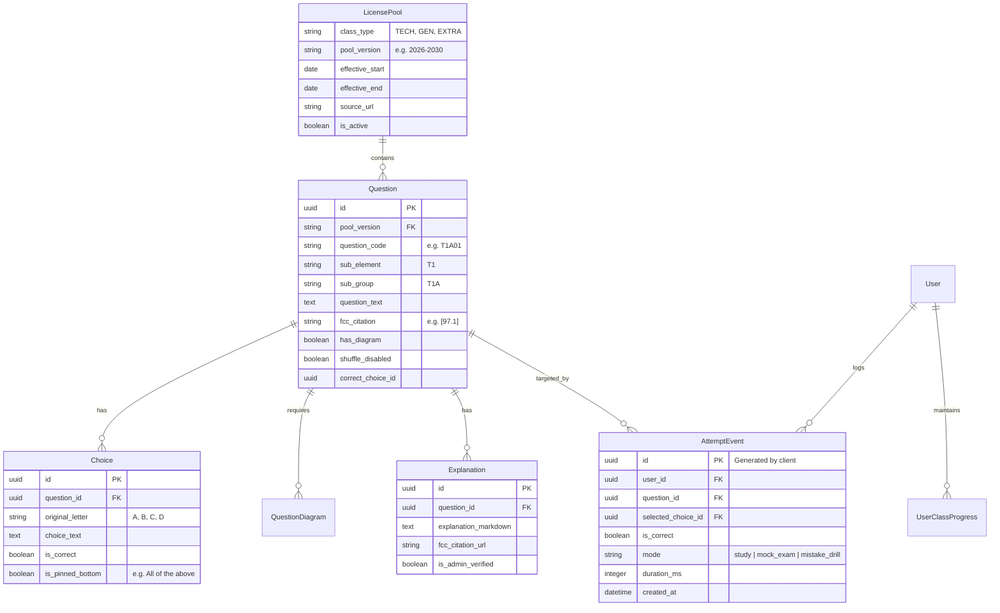
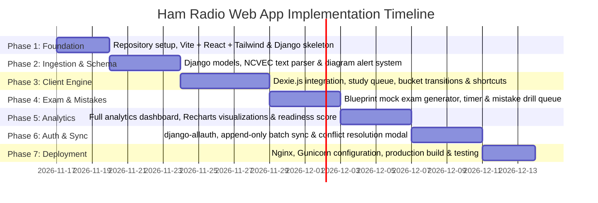

# Ham Radio License Exam Prep Web App: Master Implementation Plan

## 1. Executive Summary & Architecture Overview

This project is a modern, responsive, local-first web application designed to prepare candidates for the three FCC Amateur Radio license examinations: **Technician**, **General**, and **Amateur Extra**. 

### Core Architectural Pillars
* **Local-First, Zero-Friction Onboarding:** Users can start studying immediately as a guest without creating an account. All state, attempts, and bucket transitions are tracked locally in IndexedDB via **Dexie.js**.
* **Append-Only Synchronization:** Interactions (study answers, mock exams) are logged as immutable events. When an account is created or linked, unsynced events batch-sync to the Django backend using `ignore_conflicts=True`.
* **Hybrid Study Engine:** Combines dynamic bucket states (*Unseen*, *Needs Work*, *Learning*, *Mastered*) with a 7-day time-decay multiplier and customizable focus presets.
* **Exact FCC Blueprint Simulation:** Mock exams strictly enforce NCVEC sub-element quotas (35 questions for Tech/General, 50 for Extra) with withheld feedback and countdown timers.
* **Resilient Pool Pipeline:** Auto-downloads official NCVEC `.txt` pools with admin-configurable fallback URLs, diagram detection alerts, and pre-seeded AI explanations citing FCC Part 97 rules.

---

## 2. Technology Stack & Deployment Architecture



| Layer | Component | Details / Responsibility |
|---|---|---|
| **Frontend** | React 18, Vite, TypeScript | Client-side routing, rapid reactive UI, keyboard shortcuts (`1`–`4`, `A`–`D`, `Space`). |
| **Styling & UI** | Tailwind CSS, Lucide React, Recharts | Clean, high-contrast accessible study interface and interactive analytics charts. |
| **Client Storage** | Dexie.js (IndexedDB) | Local persistence of questions, attempts, bucket stats, and mistake queues. |
| **Backend API** | Django 5.x (Django Ninja / DRF) | Authentication, pool ingestion, append-only sync endpoint, analytics aggregation. |
| **Authentication** | `django-allauth` | Hybrid Google OAuth 2.0 + Email/Password registration and login. |
| **Database** | SQLite $\rightarrow$ Oracle Cloud MySQL | Zero-maintenance local SQLite database, architected for clean migration to Oracle MySQL. |
| **Production Server** | Nginx + Gunicorn (Same VM) | Nginx serves compiled React assets and SSL; proxies API traffic to Gunicorn. |

---

## 3. Data Models & Database Schemas

### 3.1 Django Backend Relational Schema



### 3.2 Dexie.js Client-Side Schema (IndexedDB)
* **`questions`:** `id, pool_version, question_code, sub_element, sub_group, fcc_citation, shuffle_disabled, correct_choice_id`
* **`choices`:** `id, question_id, original_letter, choice_text, is_pinned_bottom`
* **`attempts`:** `id, question_id, selected_choice_id, is_correct, mode, duration_ms, created_at, synced`
* **`question_states`:** `question_id, class_type, bucket, consecutive_correct, last_attempt_at, in_mistakes_queue, mistake_consecutive_correct`
* **`explanations`:** `question_id, explanation_markdown, fcc_citation_url`
* **`sync_metadata`:** `key, value, last_synced_at`

---

## 4. Subsystem Specifications

### 4.1 NCVEC Question Pool Ingestion & Parser
* **Data Sources:** Direct fetch from official NCVEC URL with admin-configurable override URLs in Django Admin.
* **Parser Rules:**
  1. Regex extraction of Question Code (e.g. `T1A01`), Answer Key `(C)`, FCC Citation `[97.1]`, Question text, and Options `A.`, `B.`, `C.`, `D.`.
  2. **Smart Choice Flagging:** 
     * Matches regex `(?i)(all of (these|the) choices|none of the above)` $\rightarrow$ sets `is_pinned_bottom = True`.
     * Matches cross-letter text `(?i)(both [A-D] and [A-D])` $\rightarrow$ sets `shuffle_disabled = True`.
  3. **Diagram Detection:** Regex `(?i)(figure|schematic|diagram)\s+([A-Z0-9\-]+)` $\rightarrow$ marks `has_diagram = True`.
  4. **Admin Alert:** Generates an admin notification detailing all questions requiring manual figure verification.
  5. **Pre-Seeded Explanations:** Generation pipeline produces clear technical explanations paired with direct hyperlinks to eCFR Title 47 Part 97 sections.

### 4.2 Study Engine & Spaced Repetition (Hybrid Bucket + Decay)
* **Dynamic Buckets:**
  * **Unseen:** Questions not yet attempted.
  * **Needs Work:** Questions answered incorrectly or newly introduced.
  * **Learning:** Questions with 1 consecutive correct answer.
  * **Mastered:** Questions with 2 consecutive correct answers.
* **Transition Rules:**
  * Correct answer $\rightarrow$ Increments consecutive streak; 2 consecutive correct advances bucket (`Needs Work` $\rightarrow$ `Learning` $\rightarrow$ `Mastered`).
  * Incorrect answer $\rightarrow$ Demotes 1 level (`Mastered` $\rightarrow$ `Learning`, `Learning` $\rightarrow$ `Needs Work`).
* **Time-Decay:** A cron/client check evaluates questions in *Mastered*. If `now - last_attempt_at > 7 days`, question automatically demotes to *Learning*.
* **Study Focus Presets:**
  * **Balanced (Default):** Draws 50% Needs Work/Decayed, 30% Learning, 20% Unseen.
  * **Learn New Material:** Draws 70% Unseen, 20% Needs Work, 10% Learning.
  * **Review Weaknesses:** Draws 80% Needs Work/Decayed, 20% Learning.
* **Session Batching:** Users choose batch sizes of 10, 25, 50, or Continuous. Batches conclude with a Milestone Summary Modal (promotions, demotions, accuracy) with a 1-click *"Keep Going"* button.
* **Immediate Feedback:** Instant green/red highlight, explanation reveal, and Part 97 citation display.

### 4.3 Mock Exam Simulator
* **Quotas & Blueprints:**
  * **Technician (Class 1):** 35 questions (1 from each group T1A through T0C). Passing score: 26/35 (74%).
  * **General (Class 2):** 35 questions (1 from each group G1A through G0B). Passing score: 26/35 (74%).
  * **Amateur Extra (Class 3):** 50 questions (1 from each group E1A through E0C). Passing score: 37/50 (74%).
* **Exam Mechanics:**
  * Strictly withheld feedback during the test.
  * Countdown timer (default 45 minutes for Tech/General, 60 minutes for Extra) with visual warning at 5 minutes remaining.
  * Question review navigator (Mark for Review, jump to question, answered status).
  * Comprehensive post-submission review with detailed sub-element score breakdowns.

### 4.4 "Drill My Mistakes" Rescue Mode
* **Auto-Ingestion:** Every incorrect attempt in Study Mode or Mock Exams immediately adds the question code to `in_mistakes_queue = True`.
* **Exit Condition:** Must be answered correctly **twice consecutively** within the drill to exit the queue (`mistake_consecutive_correct == 2`).

### 4.5 Analytics & Progress Engine
* **Readiness Score:** Projected pass probability based on NCVEC syllabus coverage and weighted bucket mastery.
* **Sub-Element Mastery:** Interactive bar chart / radar chart showing percentage mastery per topic (e.g. *T1 - FCC Rules*, *T5 - Electrical Principles*).
* **Score Trends:** Historical line chart tracking mock exam scores over time.
* **Bucket Distribution:** Live visual breakdown of the question pool across the 4 buckets.
* **Streaks & Stats:** Daily study streak counter, total questions answered, time spent, and ranked list of weakest topics.

### 4.6 Sync, Conflict Resolution & Account Linking
* **Periodic Auto-Sync:** Background worker pushes unsynced attempts every 3 minutes when connected.
* **Manual Sync:** Persistent top-bar button indicating sync status (Synced / Syncing / Unsynced Events).
* **Guest to Cloud Account Linking:**
  * If a guest signs up for a new account: All local Dexie attempts are pushed to the new account.
  * If a guest logs into an existing account with prior history: Modal prompts:
    * **Option 1: Merge** $\rightarrow$ Combines local guest events with cloud events chronologically and refreshes Dexie.
    * **Option 2: Overwrite Local** $\rightarrow$ Replaces local Dexie database with the cloud profile.

---

## 5. Phased Implementation Roadmap



### Phase 1: Environment & Project Scaffolding (Detailed Specification)

#### 1.1 Host Environment & Directory Layout
* **Physical Location:** `/mnt/data/ham_radio_web_app/` (stored on the 50 GB persistent Oracle Cloud block volume).
* **Workspace Symlink:** `/home/ubuntu/ai_projects/ham_radio_web_app -> /mnt/data/ham_radio_web_app`.
It uses a clean decoupled monorepo structure:
```text
/home/ubuntu/ai_projects/ham_radio_web_app/
├── .venv/                         # Isolated Python virtual environment (gitignored)
├── backend/                       # Django 5.x project root
│   ├── manage.py
│   ├── config/                    # Django core configuration (settings, urls, wsgi)
│   │   ├── __init__.py
│   │   ├── settings.py            # Environment-aware settings (dj-database-url, CORS, auth)
│   │   ├── urls.py                # Top-level routing: /admin, /api/v1/, allauth endpoints
│   │   └── wsgi.py                # Gunicorn entrypoint
│   ├── core/                      # Global utilities, user accounts, custom User model
│   ├── questions/                 # Question, Choice, Pool, and Explanation models + NCVEC parser
│   │   ├── management/commands/   # CLI commands: import_ncvec_pool, seed_explanations
│   │   └── admin.py               # Django Admin with pool URL override and diagram alerts
│   ├── study/                     # Append-only attempt log, batch sync API, mistake drill
│   ├── static/                    # Collected static files for Django Admin
│   ├── media/                     # Uploaded question diagram figures
│   └── requirements.txt           # Locked Python dependencies
├── frontend/                      # React 18 + Vite + TypeScript application
│   ├── package.json
│   ├── vite.config.ts             # Dev server with /api proxy to Django (port 8000)
│   ├── tsconfig.json
│   ├── tailwind.config.js         # Custom theme: accessible high-contrast colors, dark mode
│   ├── src/
│   │   ├── components/            # UI: StudyCard, ChoiceButton, MockTimer, AnalyticsCharts
│   │   ├── db/                    # Dexie.js database definition, seed hydration, sync queue
│   │   ├── engine/                # Weighted queue sampler, bucket transition rules, 7-day decay
│   │   ├── hooks/                 # Keyboard shortcuts (1-4, A-D, Space), sync trigger
│   │   ├── pages/                 # Home/Dashboard, Study, MockExam, DrillMistakes, Analytics, Settings
│   │   └── types/                 # Shared TypeScript interfaces (Question, Attempt, BucketState)
│   └── dist/                      # Production build output (served directly by Nginx)
├── deploy/                        # Production infrastructure configuration
│   ├── nginx.conf                 # Nginx site configuration (static hosting + Gunicorn proxy)
│   └── gunicorn.service           # Systemd unit file pointing directly to .venv/bin/gunicorn
├── scripts/                       # Developer convenience automation
│   ├── setup.sh                   # One-click bootstrap: sets up venv, installs deps, runs migrations
│   └── dev.sh                     # Concurrently launches Vite dev server + Django runserver
├── .env.example                   # Environment variable blueprint
├── .gitignore
├── README.md
└── IMPLEMENTATION_PLAN.md
```

#### 1.2 Python Virtual Environment Strategy
* **Location:** `/home/ubuntu/ai_projects/ham_radio_web_app/.venv`
* **Python Runtime:** Python 3.12 (via Miniforge `/home/ubuntu/miniforge3/bin/python3`).
* **Creation Command:** `/home/ubuntu/miniforge3/bin/python3 -m venv /home/ubuntu/ai_projects/ham_radio_web_app/.venv`
* **Why this approach?**
  1. **Isolation:** Completely isolates project dependencies from system Python 3.10 and conda base packages.
  2. **Production Simplicity:** Systemd service files and Gunicorn can directly execute `/home/ubuntu/ai_projects/ham_radio_web_app/.venv/bin/gunicorn` without needing conda environment activation.
  3. **Zero Overhead:** No bloated packages; tightly managed via `backend/requirements.txt`.
* **Core Python Dependencies:**
  * `django>=5.0,<5.2`
  * `django-ninja` (fast, type-hinted OpenAPI endpoints) or `djangorestframework`
  * `django-cors-headers` (seamless local development across ports)
  * `django-allauth` (Google OAuth + Email/Password authentication)
  * `gunicorn` (production WSGI server)
  * `python-dotenv` & `dj-database-url` (clean environment variable configuration and future MySQL switching)
  * `requests` & `pypdf` (NCVEC pool fetching and verification)

#### 1.3 Node.js & Frontend Tooling Strategy
* **Runtime:** Node.js 20 LTS (installed via official NodeSource repository).
* **Package Manager:** `npm` (standard) with Vite for near-instant Hot Module Replacement (HMR).
* **Core Frontend Dependencies:**
  * `react`, `react-dom` (v18+)
  * `typescript`
  * `vite` & `@vitejs/plugin-react`
  * `dexie` & `dexie-react-hooks` (IndexedDB reactive client database)
  * `tailwindcss`, `postcss`, `autoprefixer`
  * `lucide-react` (clean, lightweight icons)
  * `recharts` (readiness score, sub-element breakdown, mastery trend lines)
  * `canvas-confetti` (exam pass celebration feedback)

#### 1.4 Environment Configuration (`.env`)
```bash
# Domain & HTTPS
DOMAIN_NAME=hamradio.privatedns.org
BASE_URL=https://hamradio.privatedns.org

# General
DEBUG=False
SECRET_KEY=ham-radio-dev-secret-key-change-in-prod
ALLOWED_HOSTS=hamradio.privatedns.org,localhost,127.0.0.1
CSRF_TRUSTED_ORIGINS=https://hamradio.privatedns.org

# Database (SQLite default, easy toggle for Oracle MySQL)
DATABASE_URL=sqlite:///../db.sqlite3

# CORS
CORS_ALLOWED_ORIGINS=https://hamradio.privatedns.org,http://localhost:5173

# Google OAuth (Redirect URI: https://hamradio.privatedns.org/accounts/google/login/callback/)
GOOGLE_CLIENT_ID=
GOOGLE_CLIENT_SECRET=
```

### Phase 2: Backend Data Modeling & NCVEC Pool Ingestion
* Implement Django models: `LicensePool`, `Question`, `Choice`, `Explanation`, `AttemptEvent`.
* Write regex-based NCVEC `.txt` parser supporting Technician, General, and Extra pools.
* Implement smart option pinning for *"All of the above"* and cross-letter choices.
* Implement diagram detection alert in Django Admin.
* Seed initial pool questions and AI-generated explanations with FCC citations.
* Expose read-only API endpoints for frontend pool hydration.

### Phase 3: Client Database & Core Study Engine
* Configure Dexie.js database schemas and hydration routine.
* Implement Active License Class switcher in the top navigation.
* Build the Study Engine: dynamic buckets, 2-correct promotion / 1-wrong demotion rules.
* Implement the 7-day time-decay calculation.
* Build Study Focus Presets (*Balanced*, *Learn New*, *Review Weaknesses*).
* Implement batch pacing selector (10, 25, 50, Continuous) and milestone summary modal.
* Implement desktop keyboard shortcuts (`1`–`4`, `A`–`D`, `Space`/`Enter`).

### Phase 4: Mock Exam Simulator & "Drill My Mistakes" Mode
* Implement strict NCVEC blueprint quota selector (1 question per sub-group).
* Build mock exam UI with withheld feedback, question bookmarking, and countdown timer.
* Build exam grading engine and results breakdown screen.
* Implement "Drill My Mistakes" rescue queue with 2 consecutive correct exit criteria.

### Phase 5: Comprehensive Analytics Suite
* Implement readiness score calculation algorithm.
* Build Recharts analytics dashboard:
  * Sub-element mastery bars.
  * Mock exam historical trend line.
  * Live bucket distribution donut chart.
  * Study streaks, session counts, and ranked weakest topics.
* Implement safe *"Reset Progress for this Class"* action in settings.

### Phase 6: Authentication, Append-Only Sync & Conflict Handling
* Integrate `django-allauth` for Google OAuth and Email/Password.
* Build append-only event sync endpoint in Django with `ignore_conflicts=True`.
* Implement Dexie.js sync queue and background timer.
* Build the account linking conflict modal (Merge vs. Overwrite).

### Phase 7: Deployment, Server Optimization & HTTPS Verification
* Install and configure Nginx and Certbot on host:
  * Setup domain: `hamradio.privatedns.org`.
  * Acquire Let's Encrypt SSL/TLS certificates via Certbot (`certbot --nginx -d hamradio.privatedns.org`).
  * Configure automatic HTTPS redirection (HTTP:80 $\rightarrow$ HTTPS:443) with HSTS, TLS 1.2/1.3, and modern ciphers.
* Configure Gunicorn WSGI server as a systemd service (`/etc/systemd/system/hamradio.service`) pointing to `.venv/bin/gunicorn`.
* Configure Nginx reverse proxy:
  * Proxy `/api/` and `/admin/` to Gunicorn Unix socket / `http://127.0.0.1:8000`.
  * Serve compiled frontend `/dist/` static files directly with gzip compression and client-side SPA route fallback (`try_files $uri $uri/ /index.html`).
  * Serve `/static/` and `/media/` (diagrams) with caching headers.
* Configure Django production security headers: `SECURE_SSL_REDIRECT = True`, `SESSION_COOKIE_SECURE = True`, `CSRF_COOKIE_SECURE = True`.
* Perform end-to-end testing across offline study, sync resumption, and mock exams under HTTPS.
* Document future migration guide to Oracle Cloud Free MySQL.

---

## 6. Verification & Test Plan

1. **Parser & Ingestion Verification:**
   * Run parser against Technician, General, and Extra `.txt` pool files. Verify exact question counts (Tech: ~411, General: ~429, Extra: ~712).
   * Verify all questions with diagrams are properly flagged with admin alerts.
   * Verify smart pinning correctly anchors *"All of these choices are correct"* to position D.
2. **Study Engine & Decay Verification:**
   * Unit test bucket transitions: 2 consecutive correct moves question up; 1 incorrect drops it down.
   * Simulate a 7-day clock jump to verify Mastered questions decay to Learning.
   * Verify keyboard shortcuts correctly trigger choice selection and submission.
3. **Mock Exam Blueprint Verification:**
   * Validate that 100 consecutive generated mock exams strictly contain exactly 1 question per sub-element group and match the 35 or 50 question quota.
   * Confirm that feedback is 100% withheld until the "Submit Exam" button is clicked.
4. **Offline & Sync Verification:**
   * Answer 25 questions as a guest with network disconnected.
   * Reconnect network and log in: verify that the Conflict Modal prompts the user, and selecting "Merge" accurately merges guest events into the cloud database.
